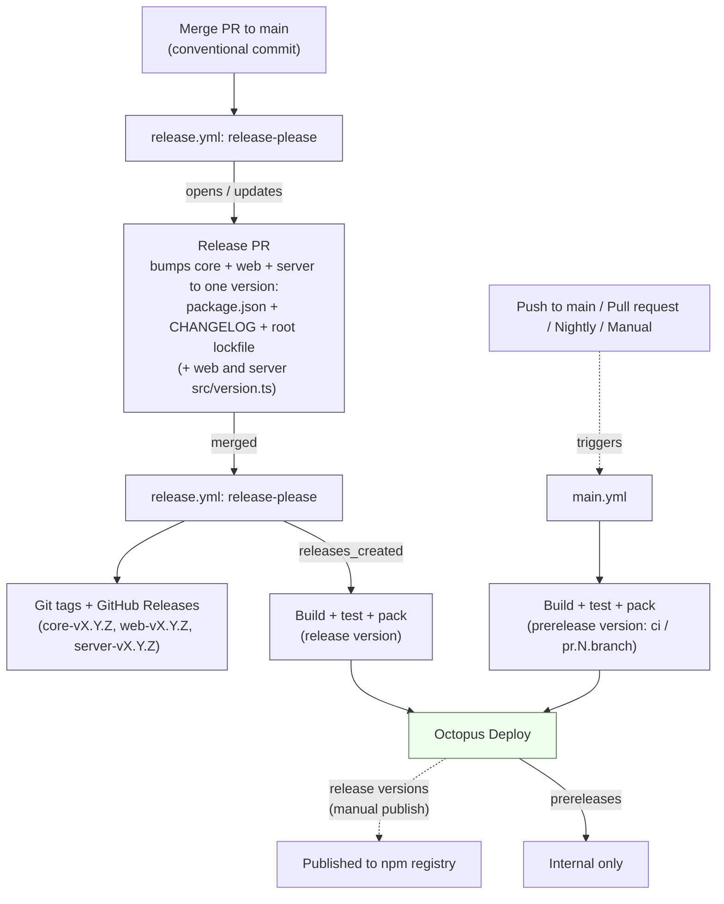

# Releasing

Versioning and publishing are automated. Release Please owns the versions and changelogs; GitHub Actions builds, tests, and packs the packages; and Octopus Deploy publishes release versions to the npm registry.

## Pipeline

- **Release builds** run after a Release Please PR is merged; the packages are pushed to Octopus Deploy, from which the release version is published to the npm registry by a manual action.
- **Prerelease builds** run on pushes to `main`, the nightly schedule, and manual dispatches (all tagged `ci`), and PRs (`pr.<number>.<branch>`). These are pushed to Octopus Deploy and stay internal, except for fork PRs and Dependabot branches, which upload the packages as a GitHub Actions artifact instead. Every package is stamped with the same prerelease version, and web's and server's exact pins on core are rewritten to match, so a prerelease provider always installs the core it was built with. Each provider's `src/version.ts` stays at the release base.

## Versioning

The packages under `packages/` are released in lockstep: a releasable commit touching any one of them bumps all of them to the same version, in a single release PR. Each package is tagged with its component name (`core-vX.Y.Z`, `web-vX.Y.Z`, `server-vX.Y.Z`). Releases up to and including 6.0.0 predate the split and use unprefixed tags (`vX.Y.Z`). Every build packs every released package, pushes them all to Octopus Deploy, and creates one release that references all of them.

The server provider in `packages/server` is released like web, except that it's published under the `beta` npm dist-tag rather than `latest`, so `npm install @octopusdeploy/openfeature-server` doesn't install it and users opt in with `@octopusdeploy/openfeature-server@beta`. The tag is set by the server publish step in Octopus Deploy, not in the repository. Promoting server to `latest` is tracked in [BMBB-1398](https://linear.app/octopus/issue/BMBB-1398).

The release workflow can also be run manually from the Actions tab to re-run Release Please without pushing a commit, for example after a failed run. Manual runs only do anything on `main`; runs from other branches are skipped. Re-running a release build after a partial failure is safe: packages and releases that already exist in Octopus Deploy are skipped rather than replaced.

## Cutting a release

1. Merge changes to `main` using a [conventional commit message](https://www.conventionalcommits.org/).
2. Release Please opens or updates a **release PR** that bumps every package to the same version and updates each changelog.
3. Merge the release PR. The tags, GitHub releases, build, and push to Octopus Deploy run automatically.
4. Promote the release to the npm registry manually from Octopus Deploy.
5. Confirm the artifacts at npmjs.com: [web](https://www.npmjs.com/package/@octopusdeploy/openfeature) and [server](https://www.npmjs.com/package/@octopusdeploy/openfeature-server?activeTab=versions), where the new version should carry the `beta` tag.
